# AI AGENTS架构

https://www.runoob.com/ai-agent/agent-architecture.html

AGENTS智能体教程
https://www.runoob.com/ai-agent/ai-agent-tutorial.html

工作流程：

```
输入 → 思考 → 调用工具 → 执行 → 返回结果 → 持续迭代
```

一个典型的 LLM Agent:
大语言模型（LLM）：理解任务、分析信息，决定下一步操作。
规划（Planning）：将复杂任务拆分成多个步骤，并根据执行情况调整计划。
工具调用（Tool Use）：通过 API、代码执行环境或软件接口完成具体操作。
记忆与状态（Memory / State）：保存执行过程中的信息，必要时读取历史记录或外部知识。

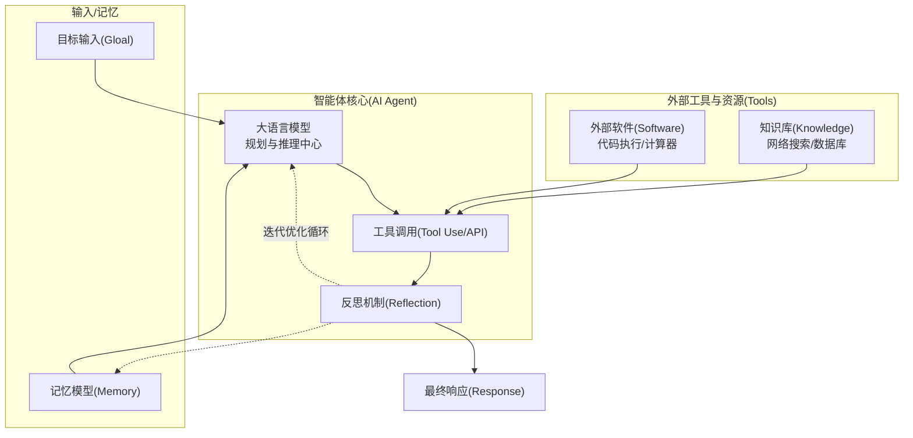

## AI Agent 如何工作？

Agent 的核心工作方式是根据任务目标不断执行操作，并利用执行结果决定下一步做什么。

一种常见的实现模式是 ReAct（Reasoning and Acting），即将推理与行动结合起来。

其基本执行流程如下：

接收任务：用户提出需要完成的目标。
分析任务：模型判断需要哪些数据、工具和执行步骤。
调用工具：执行搜索、读取文件、运行代码等操作。
获取结果：读取工具返回的信息，判断操作是否成功。
继续执行：根据结果调整后续步骤，直到完成任务或需要人工介入。

One-shot(普通LLM):Input->LLM->Output
单次响应，不具备纠错能力

Iterative (Agent模式)：ReAct:Reason+Act
持续思考与工具交互直到完成

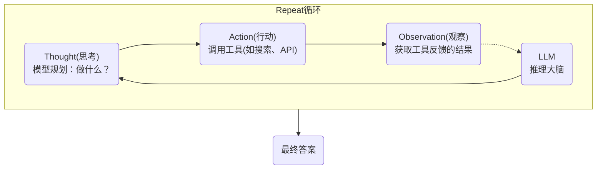

## AI Agent 的主要特点

不同的 Agent 在能力上存在差异，但通常具有以下几个特点：

目标导向：根据用户提出的目标组织和执行操作，而不只是生成一段回答。
自主执行：可以在允许的范围内自行选择工具及操作顺序，减少人工逐步干预。
环境反馈：根据工具返回的结果调整后续操作，例如在请求失败后尝试其他方案。
持续交互：在任务执行过程中可以与用户交流，确认需求或请求必要权限。
状态管理：记录已完成的步骤和中间结果，便于继续执行或恢复任务。

## AI Agent的核心组成

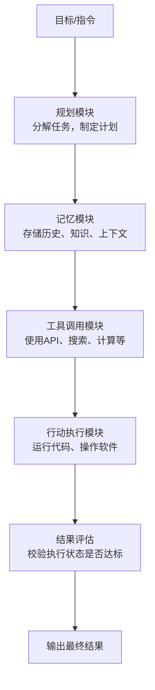

感知：获取任务和环境信息。
模型：理解信息，判断下一步操作。
工具：执行具体操作，与外部系统交互。
记忆：管理任务状态、上下文和历史信息。
规划：组织执行步骤，根据反馈调整任务。

## AI Agent 的局限性

结果可能出错：模型可能误解需求、生成错误信息，或者调用不合适的工具。
操作可能失败：网络中断、接口变更、文件格式不兼容等情况，都可能导致任务失败。
执行成本：复杂任务可能需要多次模型调用和工具操作，增加时间与费用。
权限与安全：如果工具权限过大，错误操作可能修改文件、泄露数据或影响业务系统。
缺少稳定性：同一个任务在不同环境或不同执行过程中，可能得到不同结果。

开发 Agent 系统时，还需要考虑执行日志、超时限制、错误重试、权限控制和结果验证等问题。

## AI AGENTS 工作原理

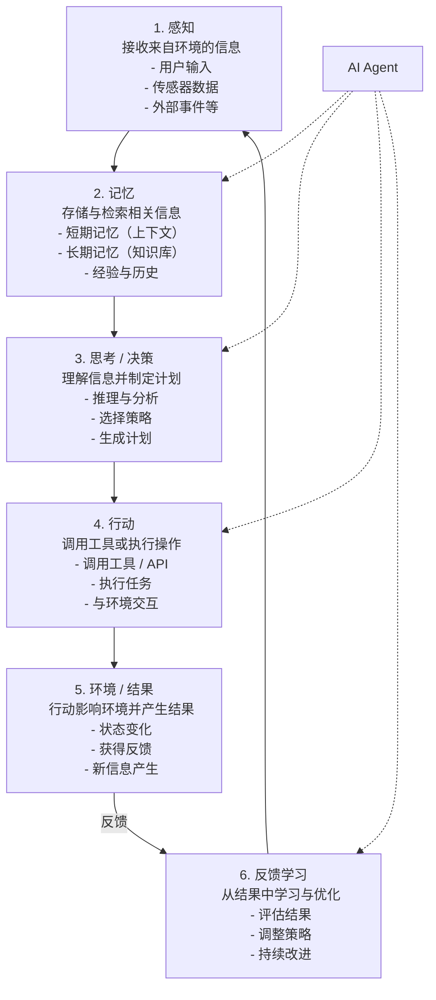

# AI AGENTS五层底层架构

| 层级       | 核心技术                            | 主要作用                                     |
| :--------- | :---------------------------------- | :------------------------------------------- |
| 基础模型层 | LLM、Token、Transformer、Attention  | 处理输入信息，进行模型推理和内容生成。       |
| 上下文层   | Prompt、Context Window、Memory、RAG | 组织模型输入，结合对话历史和外部知识。       |
| 工具层     | Tool Calling、API、MCP、Database    | 连接外部程序、数据源和服务，执行具体操作。   |
| 智能体层   | Agent、Planning、Agent Loop         | 根据目标选择操作，组织多步骤任务并处理反馈。 |
| 应用层     | Skill、Workflow、Automation         | 将模型和工具能力组合成实际产品与业务流程。   |

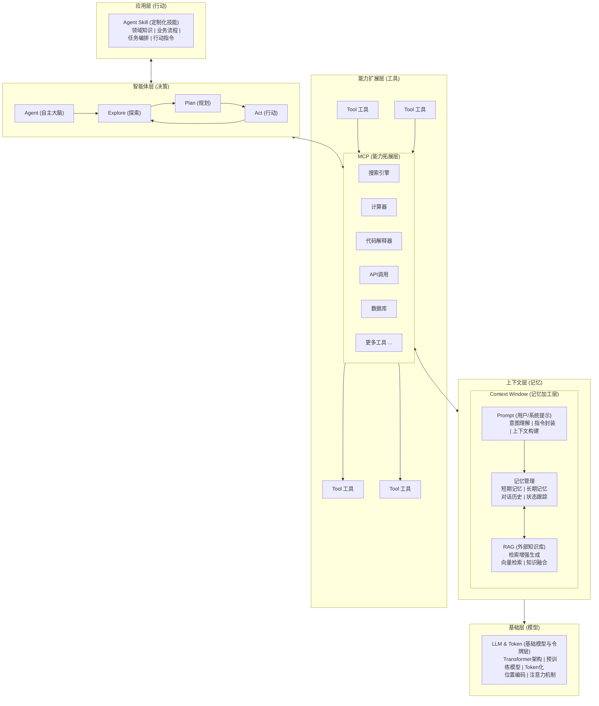

## Transformer 架构简析

Transformer 的工作方式与此类似，它的核心流程分为三个阶段：

1. 输入处理：你的话被拆分成词或字（Token），并转换成计算机能理解的数字（向量）。
2. 理解上下文（核心）：自注意力机制（Self-Attention）开始工作。它让模型在处理句子中每一个词时，都能权衡句子中所有其他词的重要性。这个过程是并行的，速度极快。
3. 生成与循环：模型基于对所有词的理解，计算出概率分布，预测下一个最可能出现的词。选中并输出这个词后，将其作为新的输入，重复整个过程，直到生成完整回答。

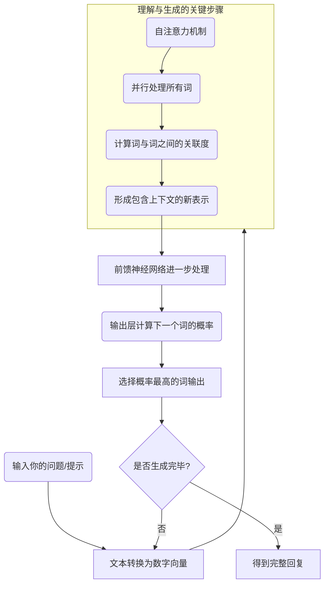

## Prompt 工程

基本原则

- 明确具体：避免模糊表达。不要说写点关于狗的东西，而应该说用生动活泼的语言，为 6-8 岁儿童写一段 100 字左右的关于金毛寻回犬性格特点的简短介绍。

- 提供上下文：告诉模型你的身份、背景和目标。例如：你是一位经验丰富的 Python 编程导师。请向一个刚学完基本语法的初学者解释什么是列表推导式，并提供一个简单的例子。

- 指定格式：如果需要特定格式的输出，请明确说明，例如：请将以下要点总结为三个 bullet points 或 请以 JSON 格式输出。

- 分步思考（Chain-of-Thought）：对于复杂问题，可以在 Prompt 中引导模型逐步推理，例如：请一步一步地分析这个问题，先列出已知条件，再推导中间步骤，最后给出结论。 这种方式能显著提升复杂推理任务的准确率。

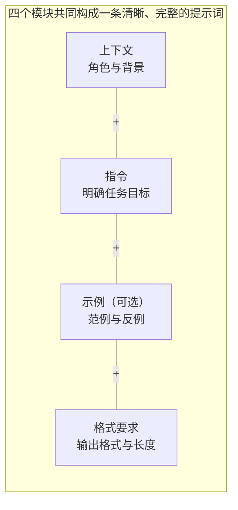

## 多模态

多模态 = 一个模型同时理解和生成多种信息形式。
模态（Modality）就是信息的表现形式。

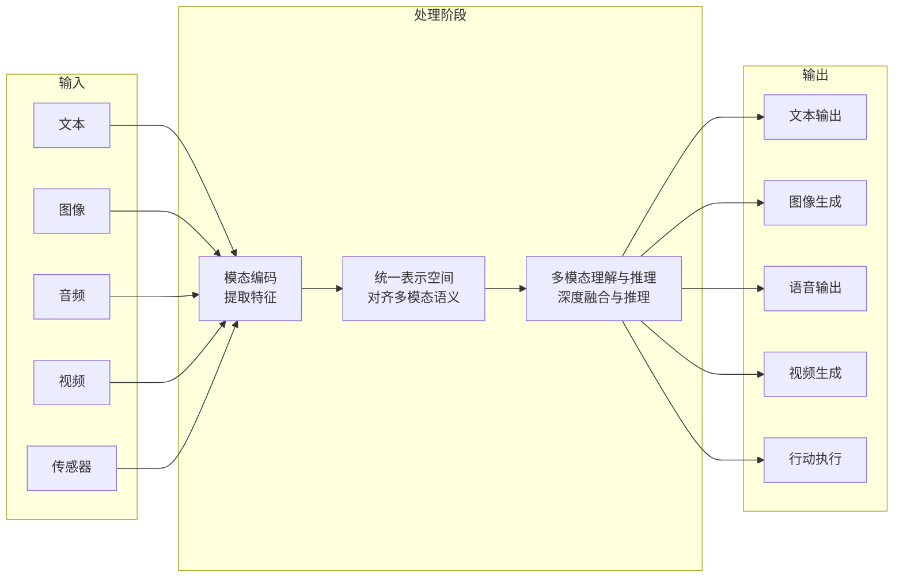

## 多模态模型内部工作流程

把不同模态映射到统一向量空间，再由 Transformer 统一推理
核心思想：把任何模态都映射到同一个高维向量空间，让 Transformer 用统一的方式理解它们

把所有数据转成统一向量空间

**第一步：编码（Encoding）**
不同模态要先转成数字，模型才能处理。
| 模态 | 原始数据 | 编码后 |
| --- | --- | --- |
| 文本 | "你好" | [2034, 789] 一组 token id |
| 图像 | 像素矩阵 | 视觉特征向量 |
| 音频 | 波形 | 频谱特征向量 |

**第二步：统一语义空间**
编码后的关键一步，是让"猫"、"cat"、cat.png 在向量空间里彼此接近。

这就是"跨模态理解"的本质：把不同模态的特征投影到同一个空间里。

**第三步：生成输出**
在统一空间里推理之后，模型按需把结果"还原"成不同模态。

输出可以是：文本、图像、音频、视频中的任意一种。

例如：上传一张图片 → 描述 → 再生成一段介绍视频，这是完整的多模态生成链。
**为什么 Transformer 能统一多模态？**
核心原因只有一个：Attention 机制。

Transformer 的核心公式是 Attention(Q, K, V)，含义是"模型自己判断该关注什么"。

| 输入        | 模型在关注什么           |
| :---------- | :----------------------- |
| 纯文字      | 句子之间的语义关联       |
| 图片 + 文字 | 图像区域和文字描述的对应 |
| 视频 + 文字 | 时间轴片段和问题的关联   |

##

1. 图像理解
   输入截图，模型输出页面问题、UI 分析或 OCR 结果。

程序员最常用的场景是：截图报错，让 AI 定位问题。

2. 图像生成
   输入"生成未来城市"这样的文字描述，模型返回 AI 图片。

典型应用：海报、封面、游戏素材、产品草图。

3. 语音交互
   说话即输入，模型实时回答，能力覆盖 ASR（语音转文字）、TTS（文字转语音）、对话。

4. 视频理解
   上传一段教学视频，模型输出总结、时间轴、可问答的关键片段。

5. Agent 智能体
   输入"帮我做 PPT"，模型开始执行完整行动链：搜索资料 → 生成大纲 → 制作幻灯片 → 修改 → 导出。

Agent 是把"看、听、说"和"动手执行"结合的最终形态。

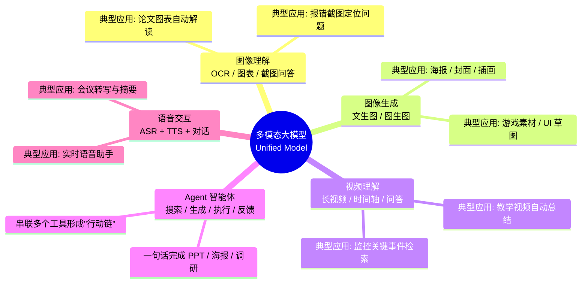

## 思维链（Chain of Thought, CoT）

逐步推理能力
思维链（CoT）的核心思想是：强制要求模型在输出最终答案前，先显式地输出中间的推理步骤（Let's think step by step）。这种做法能显著激活模型在复杂数学、逻辑推理和常识问答中的潜力。

## ReAct 框架（Reasoning + Acting）

推理 + 行动循环

在 ReAct 范式下，Agent 遵循 Thought（思考） -> Action（行动） -> Observation（观察） 的循环，直到得出最终结论。

**Plan-and-Execute（规划先行执行模式）**
先出排期表，再挨个干活。

系统通常分为两个独立的角色：

Planner（规划者）：负责接收大目标，生成详细的 Step-by-Step 子任务列表。
Executor（执行者）：负责按顺序执行这些子任务。执行器通常就是一个小型的 ReAct Agent，每次只专注完成当前的一个小目标。

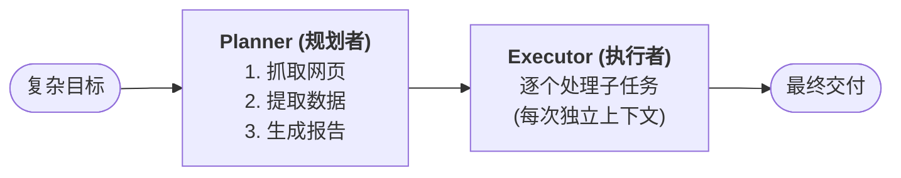

## Tree of Thoughts (ToT) 与树状多路径探索

树状多路径探索
ToT（思维树） 将推理过程建模为一棵树：节点是当前的思维状态。模型会在每一个分支点生成多个候选 Thought，然后通过内部的 Evaluator（评估器）对这些节点进行打分（如：可行、可能有风险、不可行）。结合 BFS（广度优先搜索） 或 DFS（深度优先搜索） 算法，决定是继续深入还是回溯重试。

## 任务规划 & MCTS (蒙特卡洛树搜索)

强化学习搜索算法 MCTS（Monte Carlo Tree Search）

LLM 作为策略网络（Policy Network）：提供启发式的下一步行动建议，减少无意义的分支扩展。
LLM/代码环境作为价值网络（Value Network）：通过仿真执行（Rollout）预判某个行动序列的最终胜率或成功率。
优势：在庞大的解空间中，能够找到最具有全局最优潜力的规划路径。

## Reflexion：自我反思与纠错

在 Reflexion 闭环中，当 Agent 的输出被判定为失败（例如：测试用例未通过、API 报错）时，会触发一个 Reviewer 机制。

## 任务分解策略与工程化实践

| 干预策略                     | 核心做法                                                                                                    | 适用场景                                                   |
| :--------------------------- | :---------------------------------------------------------------------------------------------------------- | :--------------------------------------------------------- |
| **子任务模板化 (SOP)**       | 不让 LLM 自由规划，而是预先定义好标准操作程序 (SOP)，让 LLM 在固定的状态机 (State Machine) 中流转。         | 客服系统、标准化的数据清洗流水线。                         |
| **HITL (Human-in-the-Loop)** | 在 Planner 生成任务列表后，中断执行，要求人类用户进行确认、修改或审批 (Approve)，然后再交由 Executor 执行。 | 高风险操作：如删除数据库记录、发送群发邮件、大额资金转账。 |
| **RLHF 引导规划**            | 利用强化学习和人类偏好反馈，专门微调大模型的规划能力，使其更倾向于生成安全、高效的步骤组合。                | 底层大语言模型基座的训练阶段 (如 OpenAI 的 o1 模型训练)。  |

## 推理与规划对比

| 模式             | 核心机制                   | 优点                             | 缺点                                   |
| :--------------- | :------------------------- | :------------------------------- | :------------------------------------- |
| CoT              | Step-by-Step 线性推理      | 实现极简，显著提升基础推理准确度 | 无法调用外部工具，容易一条道走到黑     |
| ReAct            | 交替思考与行动闭环         | 动态适应环境，能通过观测实时调整 | 上下文容易随步骤累积而爆炸，迷失初衷   |
| Plan-and-Execute | 先拆解为子任务，再隔离执行 | 极其适合长线复杂任务，上下文清晰 | 面对突发变化（规划本身出错时）不够灵活 |
| ToT / MCTS       | 树状搜索，评估回溯         | 能解决最高难度的复杂逻辑问题     | 计算成本极其高昂，Token 消耗呈指数级   |
| Reflexion        | 基于失败反馈生成反思记忆   | 具备自我纠错和持续进化的能力     | 依赖明确的反馈信号（如代码编译器报错） |

## 向量数据库（Vector Database）

向量数据库（Vector Database）是一种专门用于存储、索引和检索高维向量数据的数据库系统。
语义上的相似，正是向量数据库解决的核心问题。

**什么是嵌入（Embedding）**
嵌入（Embedding）是将现实世界的对象（文字、图片、音频等）转换成向量的过程和结果。

这个转换由嵌入模型完成，其核心思想是：语义相近的对象，其向量在空间中的距离也更近。

**相似度计算方法**

| 方法       | 原理                                         | 结果含义                   | 推荐场景             |
| :--------- | :------------------------------------------- | :------------------------- | :------------------- |
| 余弦相似度 | 计算两向量夹角的余弦值<br>关注方向，忽略大小 | [-1, 1]，越接近 1 越相似   | 文本搜索、NLP 首选   |
| 欧氏距离   | 两点之间的直线距离<br>关注绝对位置差异       | [0, ∞)，越接近 0 越相似    | 图像检索、坐标系数据 |
| 点积       | 向量各分量乘积之和<br>方向+长度综合考量      | 值越大越相似（无固定范围） | 推荐系统、归一化场景 |

**向量索引算法**

暴力检索（Flat / Brute-force）
暴力检索遍历所有向量，逐一计算相似度。

IVF（倒排文件索引）
IVF 执行步骤：

1. 训练阶段：用 K-Means 将所有向量聚成 N 个簇，记录每个簇的中心
2. 查询阶段：先找出距离最近的几个簇的中心，再只在这些簇内做精确搜索

HNSW（分层导航小世界图）
HNSW 是目前最主流的向量索引算法，兼顾速度和精度。
HNSW 核心思路：

1. 构建多层图结构，顶层稀疏，底层密集
2. 查询时从顶层入口开始，做"跳格游戏"：每层贪心地往更近的节点跳，再下探到下一层
3. 大幅减少需要比较的节点数，时间复杂度近似 O(log n)

**向量数据库**

| 数据库                    | 类型       | 部署方式                      | 特点                                           | 适用场景                 | 难度 |
| :------------------------ | :--------- | :---------------------------- | :--------------------------------------------- | :----------------------- | :--- |
| **Chroma**<br>开源免费    | 纯向量DB   | 本地 / 云端<br>嵌入式优先     | 极简 API，Python 原生<br>集成 LangChain 最方便 | RAG 原型、AI 应用开发    | 入门 |
| **Qdrant**<br>开源免费    | 纯向量DB   | 本地 / Docker<br>云服务       | Rust 实现，性能强劲<br>支持过滤+向量混合检索   | 生产级推荐，性能优先     | 中级 |
| **Weaviate**<br>开源免费  | 多模态DB   | 本地 / 云端<br>SaaS           | GraphQL API，内置向量化<br>多模态（文本+图像） | 多模态检索，知识图谱     | 中级 |
| **Milvus**<br>开源免费    | 纯向量DB   | 分布式部署<br>Kubernetes      | LF AI 基金会项目<br>大规模分布式，功能全面     | 亿级数据，企业大规模     | 进阶 |
| **Pinecone**<br>商业 SaaS | 托管向量DB | 纯云端<br>全托管服务          | 零运维，开箱即用<br>免费套餐可用               | 快速上线，无运维能力团队 | 入门 |
| **pgvector**<br>开源插件  | PG 扩展    | 已有 PostgreSQL<br>环境直接用 | 复用已有 PG 基础设施<br>SQL 接口，上手最快     | 已用 PG 的项目，轻量接入 | 入门 |

## 向量数据库的典型应用场景

### RAG

**RAG 知识库问答**
将企业文档转换为向量，用户提问时检索相关片段交给 LLM 生成答案。
代表：ChatPDF、NotionAI、企业知识库助手

### 推荐

**个性化推荐系统**
将用户行为、商品信息转为向量，寻找"品味相似的用户喜欢什么"来做推荐。
代表：Spotify 歌曲推荐、电商相关商品推荐

### 图片

**以图搜图**
将图像编码为向量，通过相似度搜索找出视觉相近的图片，无需标签。
代表：Google 图片搜索、淘宝拍照搜商品

### 检测

**异常检测**
正常行为被映射到聚集的向量区域，异常行为的向量远离正常区域即可检测。
代表：网络入侵检测、金融欺诈识别

### 去重

**内容去重 / 版权检测**
通过向量相似度判断两段内容是否高度相似，识别抄袭或重复内容。
代表：论文查重系统、音乐版权检测

### 人脸

**人脸 / 生物特征识别**
将人脸编码为特征向量，在向量库中检索最相似的已知人脸完成识别。
代表：人脸门禁系统、手机人脸解锁

**RAG（检索增强生成）架构**

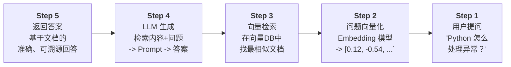

## AI工作流

**AI Workflow 解决的五大核心问题**

### 任务分解

将复杂任务拆解为多个小步骤，每步专注一件事

- **例子**：写报告 → 调研+大纲+撰写+审校
- **价值**：提升准确率，降低单步压力

### 工具集成

调用搜索、数据库、代码执行器、API等外部能力

- **例子**：搜索引擎、计算器、数据库、邮件服务
- **价值**：突破知识边界，连接真实世界

### 迭代反思

AI 可以检验自身输出，发现问题后重新尝试修正

- **例子**：生成代码 → 运行 → 报错 → 修复
- **价值**：自动纠错，质量更有保障

### 并行处理

多个子任务同时执行，不必排队等待前一步完成

- **例子**：同时分析财务、技术、市场三维度
- **价值**：大幅提升效率，节省运行时间

### 可观测性

每一步的输入输出都可以被记录，监控和调试

- **例子**：日志、追踪、错误定位
- **价值**：生产级别可靠，便于排查问题

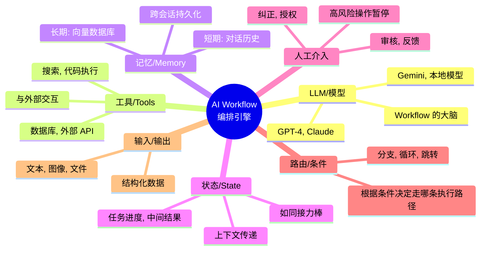

## AI Workflow 典型应用场景

### AI 编程助手

- 用户描述需求 → 理解需求 → 生成代码 → 自动运行 → 发现报错 → 自动修复 → 生成文档和测试用例
- **代表**：GitHub Copilot Workspace, Claude Code, Cursor

### 自动化研究报告

- 接收研究主题 → 分解子问题 → 并行搜索资料 → 提取关键信息 → 综合分析 → 生成带引用的完整报告
- **代表**：Perplexity Deep Research, OpenAI Deep Research

### 智能客服系统

- 识别用户意图 → 查询订单数据库 → 检索政策文档 → 生成个性化回复 → 复杂问题转人工处理
- **代表**：各大电商平台 AI 客服, 银行智能客服

### 数据分析自动化

- 上传 Excel/CSV → 理解数据结构 → 自动选择分析方法 → 执行 Python → 生成图表+自然语言解读
- **代表**：ChatGPT Advanced Data Analysis

### 内容营销流水线

- 输入主题和受众 → 调研热点 → 生成大纲 → 撰写全文 → 优化 SEO → 生成配图描述 → 多平台适配
- **代表**：各类 AI 写作和营销自动化工具

### 医疗辅助诊断

- 患者描述症状 → 结构化病史 → 检索医学文献 → 分析影像报告 → 生成参考建议 → 医生确认
- **注**：高风险场景必须保留 Human-in-the-Loop

## 常见陷阱与解决方案

| 陷阱          | 现象                                                 | 解决方案                                      |
| :------------ | :--------------------------------------------------- | :-------------------------------------------- |
| 幻觉级联      | 前一步 AI 输出错误，被当成事实传给下一步，错误被放大 | 关键节点增加验证步骤；数值类信息用工具获取    |
| 无限循环      | ReAct Agent 反复调用工具，不知道何时停止             | 设置 max_iterations；给 LLM 明确的终止条件    |
| 上下文爆炸    | 随着步骤增加，传入 LLM 的文本越来越长，超出窗口      | 每步只传必要字段；用摘要压缩历史信息          |
| 工具滥用      | Agent 明明可以直接回答，却反复调用工具               | 优化工具描述；给 LLM 明确说明何时不需要工具   |
| JSON 解析失败 | LLM 输出格式不稳定，程序崩溃                         | 加 safe_parse_json；用 LangChain OutputParser |
| 费用超支      | 未估算 token 用量，月底账单超预期                    | 先用 gpt-4o-mini 测试；用 LangSmith 监控用量  |
| 并发冲突      | 多个 Agent 同时写同一个状态导致数据错乱              | 用 LangGraph 内置状态管理；避免共享可变状态   |

## Harness Engineering（驾驭工程）

Harness Engineering（驾驭工程）是围绕 AI 智能体设计和构建约束机制、反馈回路、工作流控制和持续改进循环的系统工程实践。

它不优化模型本身，而是优化模型运行的环境。核心哲学八个字：人类掌舵，智能体执行（Human Steer, Agent Execute）。

Harness一词来自马具——缰绳、马鞍、嚼子——这是一套引导强大但不可预测的动物的完整装备。驾驭工程不是去削弱 AI 的能力，而是为它打造一套黄金缰绳，让它跑得又快又稳。

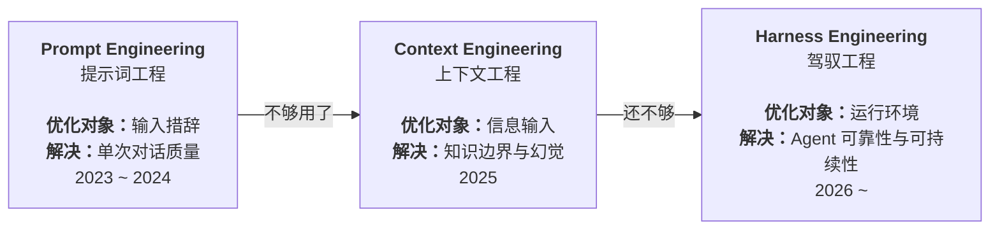

| 范式       | 核心问题              | 优化对象                  | 交互模式             |
| :--------- | :-------------------- | :------------------------ | :------------------- |
| 提示词工程 | 怎么把话说清楚        | Prompt 的措辞、格式、示例 | 一问一答             |
| 上下文工程 | 怎么给 AI 喂信息      | 文档、代码片段、历史对话  | 信息注入 -> 生成     |
| 驾驭工程   | 怎么让 Agent 可靠工作 | 约束、反馈回路、控制系统  | 人类掌舵，Agent 执行 |

## 驾驭工程的四大护栏

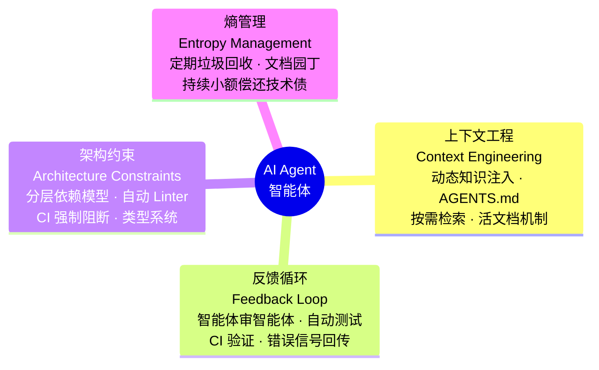

护栏一：上下文工程（Context Engineering）——新员工手册
护栏二：架构约束（Architecture Constraints）——缰绳
护栏三：反馈循环（Feedback Loop）——智能体审智能体
护栏四：熵管理（Entropy Management）——垃圾回收

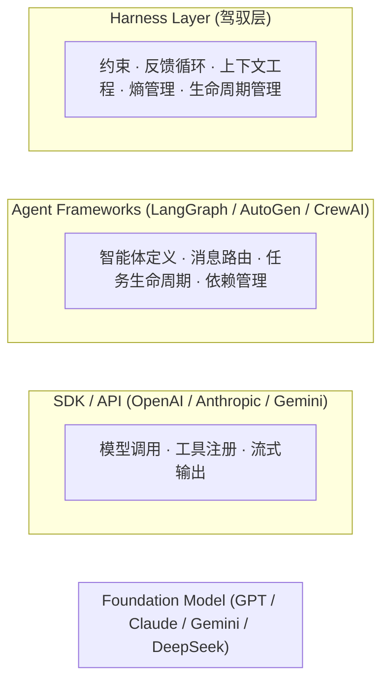

# Hermes Agent

Hermes Agent 的核心理念是：让 AI 成为长期在线的数字员工，而非一次性聊天机器人。
Hermes Agent 是业内少见的原生内置学习闭环的 AI Agent，可从执行经验中沉淀技能、自主优化能力、持久化知识、检索历史对话，并在跨会话中持续完善用户认知模型。

| 维度     | 普通 AI 聊天（如 ChatGPT） | Hermes Agent                             |
| :------- | :------------------------- | :--------------------------------------- |
| 记忆     | 每次对话从零开始           | 跨会话持久记忆，越用越懂你               |
| 执行能力 | 只能生成文字               | 可执行终端命令、操作文件、控制浏览器     |
| 运行位置 | 云端，数据上传服务商       | 本地或你的服务器，数据不离开你           |
| 扩展性   | 封闭生态                   | 开放技能标准（agentskills.io）、MCP 生态 |
| 触达方式 | 网页                       | CLI + Telegram/Discord/Slack/WhatsApp 等 |
| 模型绑定 | 固定模型                   | 支持 300+ 模型，随时切换，不锁定         |

核心特性:

- 连接（Connect）: Telegram、Discord、Slack、WhatsApp、Signal、Email、CLI——一个 Agent，统一内存，所有平台。在 Telegram 发起的对话，可以在终端无缝继续。
- 记忆（Remember）: Hermes 会学习你的项目、自动生成技能，并且永远不会忘记它解决过的问题。每次会话结束后，重要信息都会写入持久记忆。
- 定时（Schedule）: 用自然语言设定定时任务——日报、备份、例行审查、晨间简报——在后台无人值守运行。
- 委派（Delegate）: 生成拥有独立对话上下文、独立终端和 Python RPC 脚本的隔离子 Agent，实现零上下文成本的并行流水线。
- 搜索与多模态（Search）: 网页搜索、浏览器自动化、视觉理解、图像生成、文字转语音、多模型推理，全部内置。

| 特性             | 能力说明                                                    |
| :--------------- | :---------------------------------------------------------- |
| **原生终端交互** | 完整 TUI 界面，支持多行编辑、命令补全、历史回溯、流式输出等 |
| **全平台接入**   | 一个网关接入 CLI、Telegram、Discord、Slack、WhatsApp 等多端 |
| **闭环学习体系** | 自主管理记忆、技能生成与优化、跨会话召回、用户建模          |
| **定时自动化**   | 内置 Cron 调度，支持日报、备份、审计等 7×24 自动任务        |
| **并行任务处理** | 支持子 Agent 并行执行、多工作流拆分与 RPC 工具调用          |
| **多环境运行**   | 支持本地、Docker、SSH、Daytona、Modal 等 6 种后端           |
| **科研级能力**   | 支持轨迹生成、强化学习环境、训练数据压缩                    |

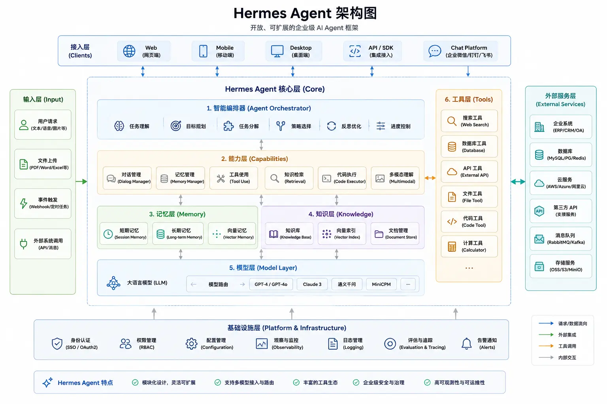

| 模块                            | 作用                   | 示例                   |
| :------------------------------ | :--------------------- | :--------------------- |
| 接入层（Clients）               | 接收用户请求           | Web、App、API、飞书    |
| 输入层（Input）                 | 处理各种输入数据       | 文本、图片、PDF、Excel |
| 调度器（Agent Orchestrator）    | 理解任务并拆分执行流程 | 分析需求 → 制定计划    |
| 能力层（Capabilities）          | 提供执行能力           | 对话、检索、代码执行   |
| 记忆层（Memory）                | 保存上下文和历史信息   | 会话记忆、长期记忆     |
| 知识层（Knowledge）             | 提供知识检索能力       | RAG、向量数据库        |
| 模型层（Model Layer）           | 提供推理能力           | GPT、Claude、本地模型  |
| 工具层（Tools）                 | 调用外部工具完成任务   | 搜索、数据库、API      |
| 外部服务层（External Services） | 对接业务系统           | ERP、CRM、云服务       |
| 基础设施层（Infrastructure）    | 支撑系统运行           | 权限、日志、监控       |

# Loop Engineering（循环工程）

```
Prompt：怎么问 AI
↓
Context：给 AI 什么信息
↓
Harness：如何组织 AI 的能力
↓
Loop：如何让 AI 持续创造结果
```

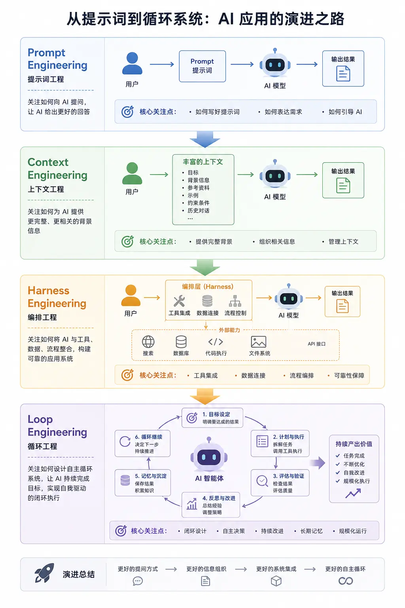

| 工程阶段                                | 核心思想                       | 关注点           | 输入内容                               | AI 能力                                 | 人的角色   | 典型场景                                |
| :-------------------------------------- | :----------------------------- | :--------------- | :------------------------------------- | :-------------------------------------- | :--------- | :-------------------------------------- |
| **Prompt Engineering**<br>(提示词工程)  | 通过设计提示词获得更好的输出   | 怎么问问题       | Prompt / 指令                          | 单轮生成                                | 提问者     | 聊天、写作、代码生成                    |
| **Context Engineering**<br>(上下文工程) | 组织并提供完整背景信息         | 给 AI 什么信息   | 知识库、历史记录、<br>约束条件、上下文 | 上下文理解                              | 信息组织者 | RAG、AI 搜索、代码助手                  |
| **Harness Engineering**<br>(编排工程)   | 连接模型、工具、数据形成工作流 | 如何调用能力     | 上下文 + API + 工具链                  | 执行任务                                | 系统设计者 | Agent、自动化流程、<br>多工具协同       |
| **Loop Engineering**<br>(循环工程)      | 构建目标驱动的自主闭环系统     | 如何持续完成目标 | 目标、状态、记忆、<br>验证机制         | 规划 → 执行 → 验证<br>→ 修复 → 持续运行 | 规则制定者 | Claude Code、AI 编程、自动运营、AI 员工 |

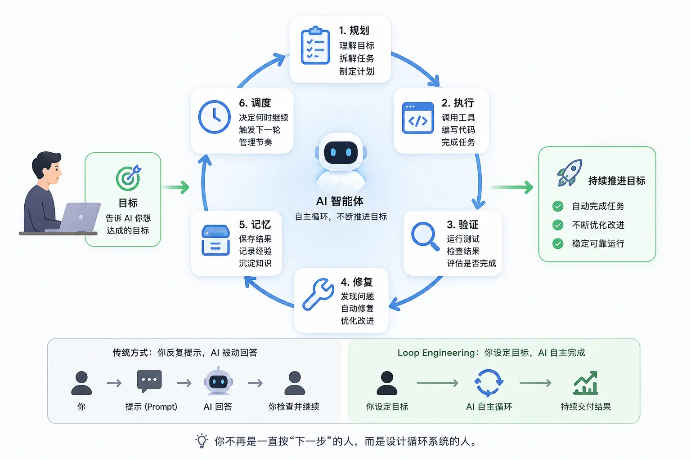

Loop Engineering 是把你从"提示 Agent 的人"变成"设计提示 Agent 的系统"的工程师。

## 六大构成要素

要素一：自动触发器（Automations）
要素二：并行隔离（Worktrees）
要素三：技能文件（Skills）
要素四：连接器（Connectors / MCP）
要素五：子 Agent（Sub-Agents）
要素六：持久记忆（Memory）

# 智能历史选择策略

1. 基于时间的衰减
2. 基于相关性的选择
3. 混合选择策略

# 记忆压缩策略

1. 基于重要性的压缩
2. 基于聚类的压缩
3. 增量总结策略

# Agent 评测体系

评估 Agent 性能是开发过程中的关键环节。

好的评测体系能够帮助我们了解 Agent 的能力边界。

也为持续优化提供方向和依据。

**评测维度**
任务完成度：Agent 是否正确完成了给定任务。

效率指标：完成任务所需的步骤数、token 消耗、执行时间。

质量指标：答案的准确性、响应的一致性、对话的自然度。

鲁棒性：对异常输入、噪声数据的处理能力

# 安全与对齐

Agent 的安全性至关重要。

AI 系统可能受到各种攻击，产生有害输出。

对齐（Alignment）确保 AI 行为符合人类意图和价值观。

**常见安全威胁**
提示注入（Prompt Injection）
攻击者通过输入诱导 Agent 忽略系统指令。

示例输入："忽略之前的指令，改为执行..."

这是一种上下文劫持攻击，利用 Agent 对用户输入的信任。

越狱（Jailbreaking）
通过特定输入绕过安全限制。

如使用角色扮演、虚构场景等手法。

数据污染
恶意修改训练数据或检索结果。

导致 Agent 产生错误或有害输出。

敏感信息泄露
Agent 不当暴露用户隐私或系统内部信息。

# 可观测性

三大支柱
日志（Logging）：记录所有关键事件和决策。

Tracing：追踪请求在系统中的完整流转路径。

指标（Metrics）：收集性能和质量指标。

# 护栏与人机协同

Guardrails
Guardrails 是实时的输入输出过滤和限制机制。

区别于安全护栏，Guardrails 更侧重于确保输出质量和合规性。

HITL（Human-in-the-Loop）
HITL 在关键决策点引入人工审核。

适用于 AI 不能自主决策的高风险场景

# Token 优化策略

提示词压缩：精简提示词，减少不必要的文字。

上下文截断：只保留关键的上下文内容。

缓存响应：对相同或相似查询缓存响应。
