# mermaid

https://www.runoob.com/markdown/md-draw.html

https://mermaid.js.org/syntax/flowchart.html#an-open-link

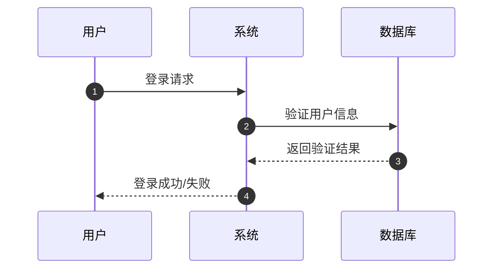

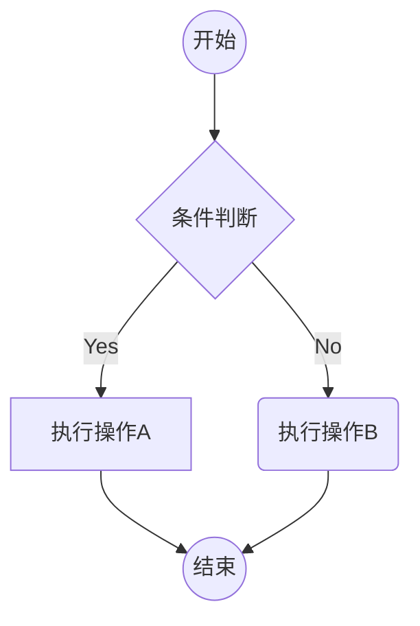

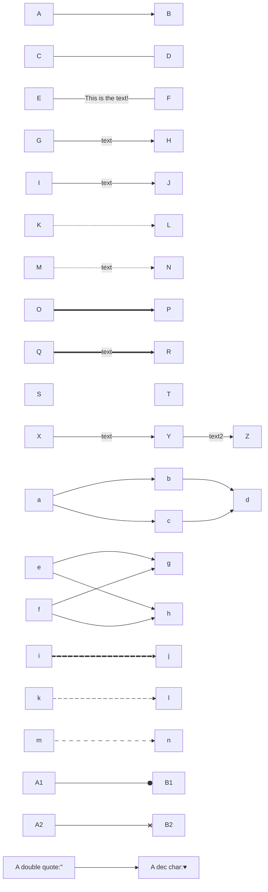

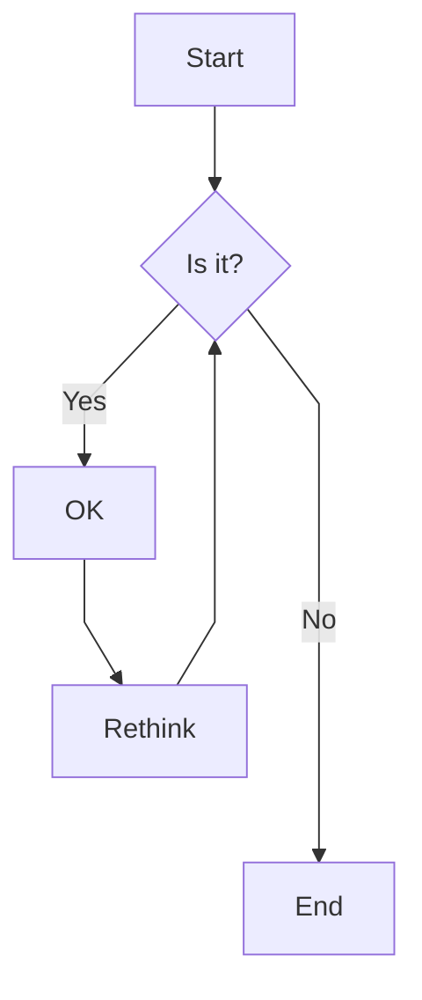

## 形状

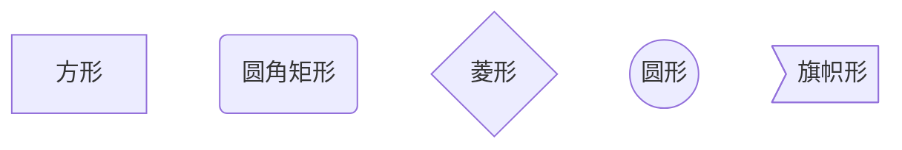

## 流程图方向

TD 或 TB：从上到下
BT：从下到上
RL：从右到左
LR：从左到右

## 虚线直线

| Length            |   1    |    2    |    3     |
| :---------------- | :----: | :-----: | :------: |
| Normal            | `---`  | `----`  | `-----`  |
| Normal with arrow | `-->`  | `--->`  | `---->`  |
| Thick             | `===`  | `====`  | `=====`  |
| Thick with arrow  | `==>`  | `===>`  | `====>`  |
| Dotted            | `-.-`  | `-..-`  | `-...-`  |
| Dotted with arrow | `-.->` | `-..->` | `-...->` |

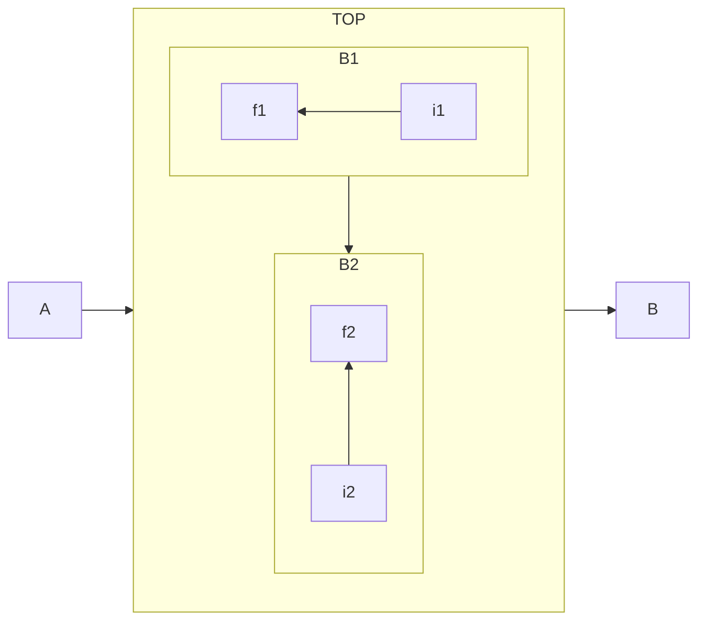

## 直线曲线

| 值                         | 效果         |
| -------------------------- | ------------ |
| `linear`                   | 直线         |
| `stepAfter` / `stepBefore` | 直角折线     |
| `basis`                    | 平滑曲线     |
| `cardinal`                 | 更柔和的曲线 |

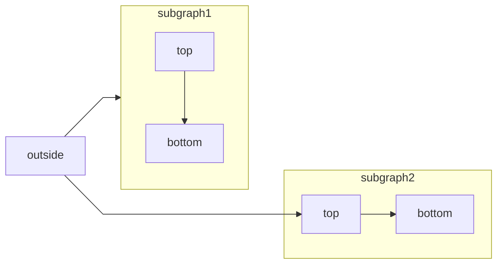

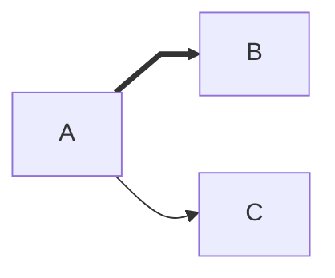

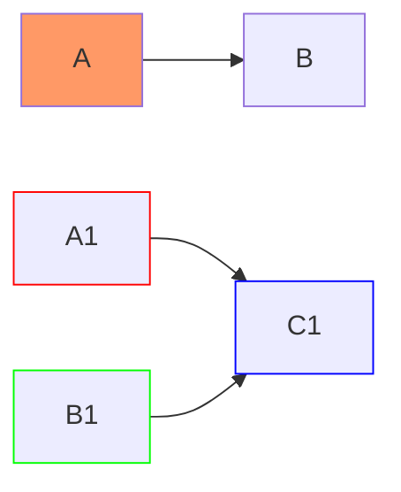

# 实例

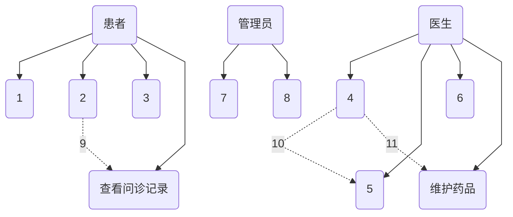

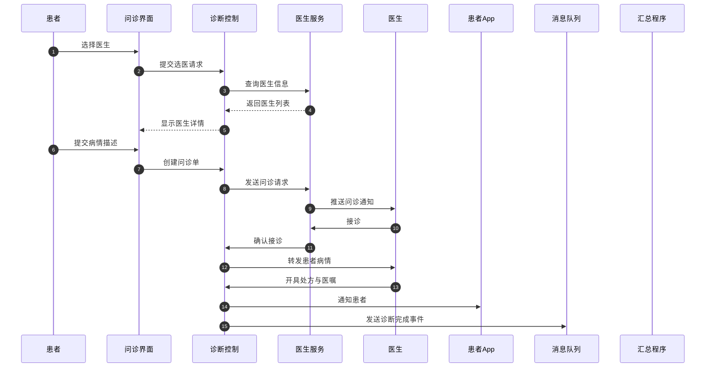

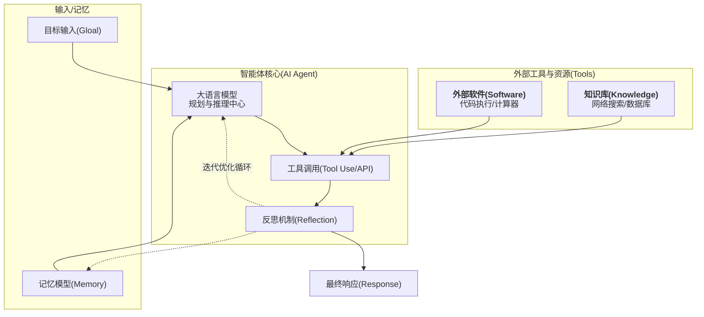

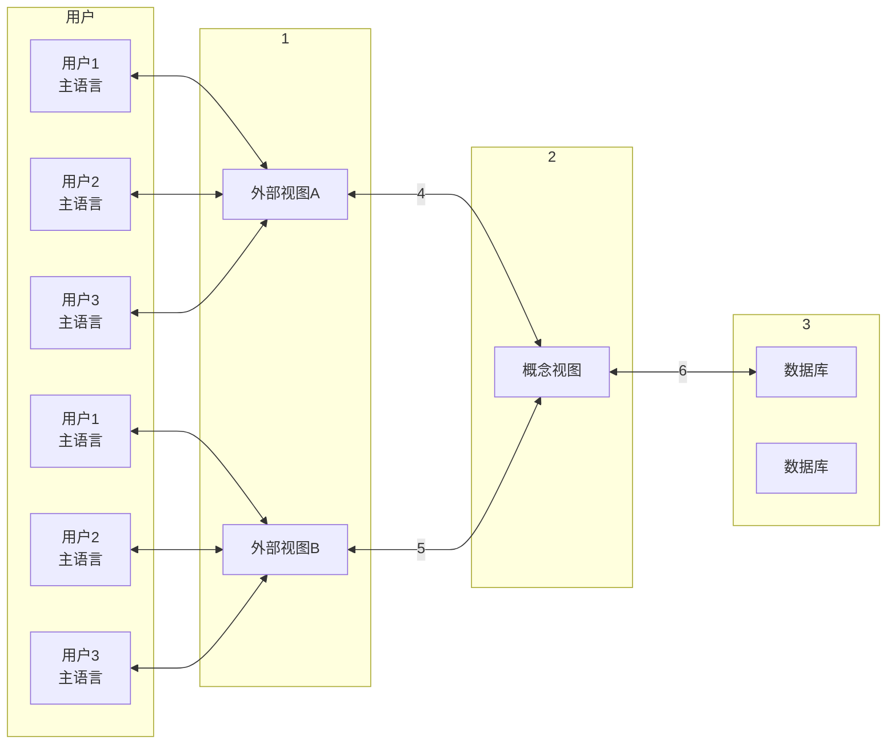
