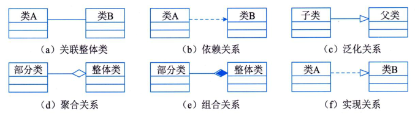

# DFD数据流图

DFD是结构化分析方法中的重要工具，是表达系统内数据流动并通过数据流描述系统功能的一种方法。

主要作用

- DFD是理解和表达用户需求的工具，是需求分析的手段，简明易懂，便于与用户沟通。
- DFD概括描述了系统的内部逻辑过程，是需求分析结果的表达工具，也是系统设计的重要参考资料，是系统设计的起点。
- DFD作为一个存档的文字资料，是进一步修改和充实开发计划的依据。

# 数据字典

数据字典是DFD的基础上，对DFD中出现的所有命名元素都加以定义，使得每个图像元素的名字都有一个确切的解释。
6类条目：数据元素，数据结构，数据流，数据存储，加工逻辑，外部实体

# STD状态转换图

STD通过描述系统的状态和引起系统状态转换的事件，来表示系统的行为。STD还指出了作为特定时间的结果将执行哪些动作（如处理数据等）

STD既可以表示循环运行过程，也可以表示单程生命期，当描述循环运行过程时，通常不关心循环是怎样启动的，当描述单程生命期时，需要标明初始状态和最终状态。

# 数据流图守恒原则

1. 加工的数据守恒（加工内部平衡）
   - 输入必须被使用：每个加工（处理过程）必须有至少一个输入数据流，且所有输入数据必须参与处理，不能被无故忽略。
   - 输出必须有来源：每个加工的输出数据必须由输入经过加工产生，不能凭空产生数据。
   - 输入输出平衡：加工的输入数据内容必须能从输入数据中通过处理逻辑得到，不能产生与输入无关的数据。
2. 分层数据流图的平衡（父图和子图平衡）
   - 父子图一致性：当加工被分解为下层子图时：
   - 子图的输入输出数据流必须与附图中对应加工的输入输出完全一致（数量和内容）
   - 子图可以展示更详细的数据流和内部加工，单不得改变附图的边界数据流。
   - 避免黑洞，灰洞与奇迹。
   - 黑洞：加工只有输入没有输出，数据无故消失。
   - 奇迹：加工只有输出没有输入，数据凭空产生
   - 灰洞：加工的输出数据无法由输入数据合理推倒，逻辑不完整。
3. 数据存储平衡
   - 数据存储必须通过加工：数据存储只能与加工交互，不能直接与外部实体活其他数据存储交换数据。
   - 读写平衡：对数据存储的读写操作需通过明确的数据流，且必须由加工出发。
4. 外部实体的数据守恒
   - 外部实体不改变数据：外部实体（数据源/终点）仅提供活接收数据，不执行加工。数据流的方向必须明确（流入或流出系统边界）
5. 数据流的一致性
   - 数据流名称一致：同一数据流在各层图中应保持名称一致。
   - 数据流内容明确：数据流应携带明确的数据内容，避免模糊命名。

# UML关系

- 依赖：两个类A和B,如果B的变化可能会引起A的变化，则称类A依赖于类B。
- 关联：关联提供了不同类的对象之间的结构关系，它在一段时间内将多个类的实例连接在一起。关联体现的是对象实例之间的关系，而不表示两个类之间的关系。其余的关系涉及类元自身的描述，而不是他们的实例。
- 泛化：泛化关系描述了一般事物与该事物中的特殊种类之间的关系，也就是父类与子类之间的关系。继承关系是泛化关系的泛关系，子类继承了父类，父类则是子类的泛化。
- 实现：实现关系将说明和实现联系起来，接口是对行为而非实现的说明，而类则包含了实现的结构。一个或多个类可以实现一个接口，而每个类分别实现接口中的操作。
- 组合：表示类之间的整体与部分的关系，部分只能属于一个整体，部分与整体之间的生命周期相同。
- 聚合：表示类之间的整体与部分的关系，部分可能同时属于多个整体，部分与整体的生命周期可以不同。

# 用例关系

- 包含关系:当可以从两个或两个以上的用例中提取公共行为时，应该使用包含关系来表示他们，其中提取出来的公共用例称为抽象用例，而把原始用例称为基本用例或基础用例。
- 扩展关系：如果一个用例明显地混合了两种或两种以上的不同场景，即根据情况可能发生多种分支，则可以将这个用例分为一个基本用例和一个或多个扩展用例，这样使描述可能更加清晰。
- 泛化关系：当多个用例共同拥有一种类似的结构和行为的时候，可以将他们的共性抽象成为父用例，其他的用例作为泛化关系中的子用例。在用例的泛化关系中，子用例是父用例的一种特殊形式，子用例继承了父用例所有的结构、行为和关系。

# 设计类的三种类型

1. 实体类：实体类保存需要存储在永久存储体中的信息，如学员类、课程类
2. 控制类：控制类用于对一个或几个用例所特有的控制行为进行建模， 控制对象(控制类的实例)通常控制其他对象，行为具有协调性。如身份验证类
3. 边界类：边界类用于封装在用例内外流动的信息或数据流。边界类位于系统与外界的交接处，包括所有窗体、报表、打印机和扫描仪等硬件的接口，以及与其他系统的接口。

# 实体对象、控制对象、接口对象

实体对象:用来表示业务域的事实数据并需要持久化存储的对象类型;
控制对象:用来表示业务系统中应用逻辑和业务规则的对象类型;
接口对象:用来表示用户与系统之间交互方式的对象类型。

# 构建用例模型的四个阶段

1. 识别参与者：确定与系统交互的外部实体（如用户、其他系统、设备、时钟等）。
2. 合并需求得到用例：定义系统每个参与者提供的功能单元（用例），每个用例描述一个具体的系统行为或目标。
3. 细化用例描述：详细描述每个用例的步骤，包括基本事件流（正常流程）和备选事件流（异常或可选流程），以明确用例的具体行为。
4. 调整用例模型：使用UML（统一建模语言）绘制图形化表示，展示参与者、用例及其之间的关系（如泛化、包含、扩展），形成完整的用例模型视图。

# 建立分析模型过程

1. 定义概念类：找到系统中的对象或类。
2. 确定类之间的关系：理清类之间关联、依赖、泛化、聚合、组合、实现等关系。
3. 为类添加职责：给类添加成员变量或属性，以及成员方法或责任
4. 建立交互图：使用顺序图、通信图、定时图、交互概览图等表示多个对象的行为。

# 数据流图与流程图的区别

数据流图作为一种图形化工具，说明业务处理过程、系统边界内所包含的功能、系统中的数据流，适用于系统分析中的逻辑建模阶段;
流程图以图形化方式展示应用程序从数据输入到获得输出为止的逻辑过程，描述处理过程的控制流，往往涉及具体技术、环境，适用于系统设计中的物理建模阶段

1. 数据流图中的处理过程可并行，流程图在某个时间点只能处于一个处理过程
2. 数据流图展现系统的数据流，流程图展现系统的控制流
3. 数据流图展现全局的处理过程，过程之间遵循不同的计时标准，流程图处理过程遵循一致的计时标准。
4. 数据流图适用于系统分析中逻辑建模阶段，流程图适用于系统设计中物理建模阶段。

# 活动图与流程图区别

1. 流程图着重描述处理过程，它的主要控制结构是顺序、分支和循环，各个处理过程之间有严格的顺序和时间关系。而活动图描述的是对象活动的顺序关系所遵循的规则，它着重表现的是系统的行为，而非系统的处理过程。
2. 流程图只能表达顺序执行过程，活动图则可以表达并发执行过程。
3. 活动图可以有多个结束状态，而流程图只能有一个结束状态。

# UML 4+1视图

- 用例视图：需求分析模型，最终用户
- 逻辑视图：展示系统功能，类与对象，系统分析、设计人员
- 实现视图：源代码结构，物理代码文件和组件，程序员
- 进程视图：并发与同步结构，线程、进程、并发，系统集成人员
- 部署视图：软件构建到物理节点映射，软件到硬件的映射，系统和网络工程师

# UML图

- 类图Class Diagram：描述一组类、接口、协作和他们之间的关系。
- 对象图Object Diagram:描述一组对象及他们之间的关系。
- 构件图Component Diagram：描述一个封装的类和她的接口、端口、以及有内嵌的构建和连接件构成的内部结构。
- 组合结构图（Composite Structure Diagram）：描述结构化类（如构件、类）的内部结构，包括结构化类与系统其余部分的交互点。
- 用例图（Use Case Diagram）:描述一组用例、参与者以及他们之间的关系。
- 顺序图（Sequence Diagram）:由一组对象或参与者以及他们之间可能发送的消息构成，强调消息的时间次序。
- 通信图（Communication Diagram）:强调收发消息的对象或参与者的组织结构。
- 定时图Timing Diagram：强调消息跨域不同对象或参与者的实际时间，不仅仅关心消息的相对顺序。
- 状态图（State Diagram）:描述一个状态机，它由状态、转移、事件和活动组成。强调事件导致的对象行为。行为建模
- 活动图Activity Diagram:将进程或其他计算结构展示位计算机内部的控制流和数据流。强调对象间的控制流程。功能建模，业务流程建模
- 部署图Deployment Diagram:描述对运行时的处理节点及在其中生存的构件的配置。
- 制品图Artifact Diagram:描述计算机中一个系统的物理结构。
- 包图Package Diagram:描述由模型本身分解而成的组织单元，以及他们之间的依赖关系。
- 交互概览图Interaction Overview Diagram:活动图和顺序图的混合物

# 活动图与状态图的定义和不同

状态图(State Diagram)。状态图描述一个状态机，它由状态、转移、事件和活动组成。状态图给出了对象的动态视图，强调事件导致的对象行为。行为建模
活动图(Activity Diagram)。活动图将进程或其他计算结构展示为计算内部的控制流和数据流。活动图专注于系统的动态视图。强调对象间的控制流程。功能建模和业务流程建模

# 流程图、数据流图、活动图的特点和使用场景

数据流图:
特点:通过系统内数据的流动来描述系统功能的一种方法。强调系统中的数据流动。包括:数据流，外部实体，加工，数据存储。
适用场景:结构化需求分析，为系统做功能建模。

流程图:
特点:能清晰展现业务执行的流程顺序。强调控制流。
适用场景:结构化需求分析与结构化设计，为系统梳理业务流程。

活动图:
特点:与流程图类似，但可以表现并行执行。
适用场景:面向对象分析与设计建模。

# 面向对象设计原则

继承：白盒复用
组合聚合：黑盒复用

Has-A:聚合或组合
Is-A：继承

1. 开闭原则:指软件实体应对扩展开发， 而对修改关闭，即尽量在不修改原代码的情况下进行扩展。
2. 里氏替换原则：一个软件实体如果使用的是一个基类对象，那么一定使用与其子类对象，而且察觉不出基类对象和子类对象的区别，即把基类对象替换成它的子类。
3. 依赖导致原则：指抽象不改依赖于细节，细节应对依赖于抽象。要针对接口编程而不是针对实现编程。
4. 组合/聚合复用原则：在一个新的对象中通过组合关系或聚合关系来使用一些已有的对象，使之成为新对象的一部分，新对象通过委派调用已有对象的方法达到复用其已有功能的目的。
5. 接口隔离原则：指使用多个专门的接口，而不使用单一的总接口。每个接口应该承担一种相对独立的角色，不多不少，不干不该干的事情，该干的事情都要干。
6. 最少知识原则（迪米特法则）：指一个软件实体应对尽可能少地与其他实体发生相互作用。

# 设计模式（简化）

**创建型**

- 工厂方法(Factory Method)：类的创建型模式，子类决定实例化
- 抽象工厂（Abstract Factory）：对象创建型模式，抽象接口
- 构建器(Builder)：对象创建型模式，类和构建分离
- 原型（Prototype）：对象创建型模式，原型实例复制
- 单例（Singleton）：唯一实例，全局访问

**结构型**

- 适配器（Adapter）模式：类结构型模式，对象结构型模式，转换，兼容接口
- 桥接（Bridge）模式：对象结构型模式，抽象和实现分离
- 组合（Composite）模式：对象结构型模式，整体-部分的树形结构层次
- 装饰（Decorator）模式：对象结构型模式，附加职责
- 外观（Facade）模式：对象结构型模式，对外统一接口
- 享元（Flyweight）模式:对象结构型模式，细粒度，共享
- 代理（Proxy）模式：对象结构型模式，代理控制

**行为型**

- 责任链（Chain of Responsibility）模式：对象行为型模式，传递请求，责任链
- 命令（Command）模式：对象行为型模式，记录请求日志，可撤销
- 解释器（Interpreter）模式：类行为型模式，编译器，虚拟机
- 迭代器（Iterator）模式：对象行为型模式，遍历访问，不暴露内部
- 中介者（Mediator）模式：对象行为型模式，不直接引用
- 备忘录（Memento）模式：保存，恢复
- 观察者（Observer）模式:对象行为型模式，通知改变，自动更新
- 状态（State）模式：对象行为型模式，状态变类
- 策略（Strategy）模式：对象行为型模式，算法替换
- 模板方法（Template Method）模式：类行为型模式，算法框架
- 访问者(Visitor)模式：对象行为型模式，数据与操作分离

# 耦合（从低到高）

无数标控外公内

无数标枪，遥控在外公室内

- 无直接耦合
- 数据耦合：传递数值
- 标记耦合：传递数据结构
- 控制耦合：控制变量，开关/指令
- 外部耦合：全局值
- 公共耦合：全局结构
- 内容耦合：模块内关联

# 内聚（从高到低）

功顺通过时逻偶
用功夫顺利通过时摞（逻）藕（偶）

- 功能内聚：单一功能，共同作用，缺一不可
- 顺序内聚：顺序执行，输入为输出
- 通信内聚：相同数据结构，相同输入输出
- 过程内聚：按特定次序执行
- 瞬时内聚（时间内聚）：同时执行
- 逻辑内聚：逻辑相似，参数决定
- 偶然内聚（巧合内聚）

# 架构风格

- 数据流体系结构风格：批处理体系结构缝，管道-过滤器体系结构体系
- 调用/返回体系结构风格：主程序/子程序风格，面向对象体系结构风格，层次型体系结构风格，客户端/服务端体系结构风格
- 以数据为中心的体系结构风格：仓库体系结构风格，黑板体系结构风格
- 虚拟机体系结构风格：解释器体系结构风格，规则系统体系结构风格
- 独立构件体系结构风格：进程通信体系结构风格，事件系统体系结构风格
- 面向服务的架构风格

# 黑盒测试

等价类划分法、
边界值分析法、
错误推测法、
因果图法、
判定表驱动法、
正交试验设计法、
功能图法和场景法

# 白盒测试（从弱到强）

(1)语句覆盖：每条语句至少执行一次。
(2)判定覆盖：每个判定的每个分支至少执行一次。
(3)条件覆盖：每个判定的每个条件应取到各种可能的值。
(4)判定/条件覆盖：同时满足判定覆盖条件覆盖。
(5)条件组合覆盖：每个判定中各条件的每一种组合至少出现一次。
(6)修改条件判断覆盖：每一个判断的所有可能结果都出现过、每一个判断中所有条件的所有可能结果都出现过、每一个进入点及结束点都执行过、判断中每一个条件都可以独立影响判断的结果。

# 信息系统战略规划ISSP

- 第一个阶段主要是以数据处理为核心，围绕职能部门需求进行的信息系统规划，主要的方法包括企业系统规划法、关键成功因素法和战略集合转化法；

- 第二个阶段主要是以企业内部管理信息系统为核心，围绕企业整体需求进行的信息系统规划，主要的方法包括战略数据规划法、信息工程法和战略栅格法；

- 第三个阶段的方法在综合考虑企业内、外环境的情况下，以集成为核心，围绕企业战略需求进行信息系统规划，主要的方法包括价值链分析法和战略一致性模型。

# 系统规划的步骤

1. 对现有系统进行初步调查
2. 分析和确定系统目标
3. 分析子系统的组成和基本功能
4. 拟定系统的实施方案
5. 进行系统的可行性研究，编写可行性研究报告，召开可行性论证会
6. 制定系统建设方案

# 问题分析阶段

1. 研究问题领域
2. 分析问题和机会
3. 制定系统改进目标
4. 修改项目计划

# 需求分类

- 业务需求：描述企业层面的业务目标，业务流程，管理策略等，是企业想达到什么目标，它关注的是组织层面的价值，业务需求不涉及系统如何实现，而强调业务问题和业务痛点

- 用户需求：指不同类型用户（管理人员，销售人员，客服等）在实际工作中对系统提出的期望和需求，描述用户需要系统提供什么。它侧重于功能性诉求，是业务需求的进一步细化。

- 系统需求：根据用户需求和业务需求分析得出的对系统功能、性能、接口、安全等方面的详细规定，是系统应该怎样实现。包括功能需求，非功能需求（性能，可靠性，兼容性等）。系统需求具有可验证性，是系统设计与开发的直接依据.

# 需求获取方法

1. 用户访谈：一对1-3个人，有代表性的用户。优点：灵活，应用范围广，可获取深度需求，缺点记录困难，时间有限，对工作人员要求较高。
2. 问卷调查：用户多，无法一一访谈。关键在于制作好调查表，优点广撒网，代价小，信息真实，结果好统计，缺点缺乏灵活性。
3. 采样：从种群中系统地选择出有代表现的样本集的过程，通过认真研究所选出的样本集，可从整体上揭示种群的有用信息。优点：提高了效率，降低了成本，减少了数据收集偏差。缺点依赖系统分析师主观因素，要求高。
   `样本数量=0.25*（可信因子/错误率）^2`
4. 情节串联版：一系列图片，通过图片讲故事。优点：给用户直观的演示，交互性强，生动。缺点：话费时间多，效率低。
5. 联合需求计划：成本高，但十分有效，通过联合各个关键用户代表，系统分析师，开发团队代表一起，通过有组织的会议来讨论需求。解决问题歧义，明确不清晰的需求。优势：发挥用户和管理人员参与系统开发过程的积极性，提高系统开发效率。降低系统需求获取的时间成本，加速开发周期。采用原型确认系统需求并获取设计审批，具有原型化开发的优点。
6. 需求记录技术：任务卡片，场景说明，用户故事，Volere白卡

# 可行性分析

- 经济可行性:成本收益分析，包括建设成本、运行成本和项目建设后可能的经济收益。
- 技术可行性:技术风险分析，现有的技术能否支持系统目标的实现，现有资源(员工，技术积累，构件库，软硬件条件)是否足以支持项目的实施。
- 法律可行性(社会可行性):不能与国家法律或政策相抵触。
- 用户使用可行性:从信息系统用户的角度评估系统的可行性。
  - 管理可行性:系统与现有管理机制的一致性，改革的可能性。
  - 运行可行性:用户方便使用的程度，及用户的素质和培训要求。

# 数据库不规范化带来问题

- 数据冗余:数据被重复存储，如某门课程有100个学生选修，那么在R的关系中就要出现100个元组，这门课程的任课教师姓名和地址也随之重复出现100次。
- 修改异常:修改导致数据不一致，如由于上述冗余问题，当需要修改这个教师的地址时，就要修改100个元组中的地址值，否则就会出现地址值不一致的现象。
- 插入异常:插入时异常，如不知道听课学生名单，这个教师的任课情况和家庭地址就无法进入数据库;否则就要在学生姓名处插入空值。
- 删除异常:删除了不该删除的数据，如当只有一条记录时，要删除这个学生选课信息，会将课程名、教师名和教师地址都给删除了。

# 数据库事务并发会出现问题

1. 丢失更新:事务1对数据A进行了修改并写回，事务2也对A进行了修改并写回，此时事务2写回的数据会覆盖事务1写回的数据，就丢失了事务1对A的更新。即对数据A的更新会被覆盖。
2. 不可重复读:事务2读A，而后事务1对数据A进行了修改并写回，此时若事务2再读A，发现数据不对。即一个事务重复读A两次，会发现数据A有误。
3. 读脏数据:事务1对数据A进行了修改后，事务2读数据A，而后事务1回滚，数据A恢复了原来的值，那么事务2对数据A做的事是无效的，读到了脏数据。

# 数据库事务封锁协议

- 丢失更新加锁:一级封锁协议。事务T在修改数据R之前必须先对其加X锁，直到事务结束才释放。
- 读脏数据加锁:二级封锁协议。一级封锁协议加上事务T在读取数据R之前先对其加S锁，读完后即可释放S锁。
- 不可重复读加锁:三级封锁协议。一级封锁协议加上事务T在读取数据R之前先对其加S锁，直到事务结束才释放。

# 数据库视图的作用

视图是一个或多个表关联查询的虚拟表
视图的优点:

1. 视图能简化用户的操作
2. 视图机制可以使用户以不同的方式查询同一数据
3. 视图对数据库重构提供了一定程度的逻辑独立性
4. 视图可以对机密的数据提供安全保护

# 分布式数据库的分布透明性

分布透明性是指用户不必关心数据的逻辑分片，不必关心数据存储的物理位置分配细节，也不必关心局部场地上数据库的数据模型。

1. 分片透明性:用户或应用程序不需要知道逻辑上访问的表具体是如何分块存储的。
2. 位置透明性:应用程序不关心数据存储物理位置的改变。
3. 逻辑透明性:用户或应用程序无需知道局部使用的是哪种数据模型。
4. 复制透明性:用户或应用程序不关心复制的数据从何而来。

# 数据库性能优化

- 增加冗余列:在多个表中保留相同的列，通过增加数据冗余减少或避免查询时的连接操作。
- 增加派生列:在表中增加可以由本表或其它表中数据计算生成的列，减少查询时的连接操作并避免计算或使用集合函数。
- 重新组表:如果许多用户需要查看两个表连接出来的结果数据，则把这两个表重新组成一个表来减少连接而提高性能。
- 水平分割表:根据一列或多列数据的值，把数据放到多个独立的表中，主要用于表数据规模很大、表中数据相对独立或数据需要存放到多个介质上时使用。
- 垂直分割表:对表进行分割，将主键与部分列放到一个表中，主键与其它列放到另一个表在查询时减少I/O次数。

# NoSQL优缺点

优点:
NoSQL数据库支持高并发数据访问，性能较高。
NoSQL数据库的数据存储结构松散，能够灵活支持多种类型的数据格式。
NoSQL数据库能够支持海量数据的存储，且易于横向扩展。
NoSQL数据库基于分布式数据存储，不存在单点故障和性能瓶颈，系统可用性高。

缺点:数据模型和查询语言没有经过数学验证。不支持ACID特性等。

# 数据库范式

- 1NF：属性值都是不可分的原子值。
- 2NF：消除非主属性对候选键的部分依赖。
- 3NF：消除非主属性对候选键的传递依赖。
- BCNF：消除主属性对候选键的部分和传递依赖。

# 容器化技术在微服务架构中的作用

1. 环境一致性：容器化技术能够将微服务及其所有依赖项打包成一个独立运行的单元，确保在不同环境中（开发、测试、生产等）运行的一致性。
2. 资源隔离：通过容器化，每个微服务都被封装在自己的容器中，实现资源（如CPU、内存、网络等）的隔离，避免微服务之间资源竞争和冲突
3. 快速部署与伸缩：容器化技术使得微服务的部署和扩展变得简单和高效，通过使用容器编排工具，可以实现自动化部署，伸缩和管理。
4. 简化运维：容器化技术简化了运维工作，通过容器编排工具，可以轻松监控服务、重启服务、日志收集、故障排查等，提高了运维效率。
5. 提升效率：相比物理主机和虚拟主机，容器化技术通过减少资源开销和优化资源利用，提升了微服务的效率性能。

# Redis与MemCached的对比

1. Redis: 支持字符串（String）、哈希（Hash）、列表（List）、集合（Set）、有序集合（ZSet）等多种复杂数据结构。Memcached:仅支持简单的键值对（Key-Value）存储，所有值都必须是字符串
2. Redis:支持 RDB（快照）和 AOF（日志）两种持久化机制，可以将内存中的数据定期保存到磁盘。即使服务重启或发生故障，数据也能得到恢复。Memcached:数据完全存储在内存中，不支持持久化。一旦服务重启或宕机，所有数据都会丢失。
3. Redis:提供原生的 Cluster 集群模式，支持自动分片、主从复制和故障自动转移，高可用、易扩展。Memcached:本身不提供集群功能
4. Redis:内置了事务、Lua 脚本、发布/订阅（Pub/Sub）、地理位置（GEO）计算、位图（Bitmap）等功能。 Memcached不具备以上功能。

# 前后端分离的优点

1. 前端（web/app）与后端（服务端）通过API进行通信，双方仅通过JSON/HTTP交互，而不再直接耦合页面与逻辑业务。
2. 前端负责UI展示与交互，后端负责业务逻辑，数据处理与存储
3. 前端与后端独立开发，独立部署，独立演进。

优点：

1. 开发效率提升：前后端并行开发，通过明确的API契约提高协作效率
2. 架构清晰、职责分离：前端负责界面，后端负责逻辑，使系统更加解耦，易于维护
3. 用户体验好：前端可用SPA视线更流畅的页面交互，与更快的响应速度。
4. 支持多端服用：同一套后端API可服务Web、APP、小程序等多段，减少重复开发。
5. 扩展与部署灵活：前后端可独立部署扩容，前端还能用CND加速，后端按需伸缩。
6. 技术栈选择自由：前端与后端各用最合适的技术，互不影响演进升级

# 在微服务架构中RESTful API的优势

1. 提供了标准的通信方式，使得微服务间可以基于HTTP协议进行通信，简化了服务间的集成
2. 使用同一的资源表示和操作方法（如GET、POST、PUT、DELETE），使得服务间的交互更加直观和易于理解
3. 支持无状态通信，每个请求都包含足够的信息供服务器处理，无需在多个请求见维护状态。
4. 支持缓存，通过HTTP请求头信息可以控制缓存行为，提高系统性能
5. 易于扩展，可以随着业务的发展轻松添加新的资源和方法

# RESTful实现前后端分离

1. 无状态性：每个请求从客服端到服务器都必须包含理解该请求所需的所有信息，服务器不会存储任何客户端的状态或会话数据，使得前后端可以独立扩展，并且任意一个都可以不影响另一个的情况下进行更新。
2. 统一接口：Restful提供了一套标准的操作集（GET,POST,PUT,DELETE）等，这些操作与资源（通常是名词形式的数据实体，如用户、订单等）相关联，这种一致性简化了前后端之间的交互，使得前端开发者可以更容易地理解和使用API。
3. 资源导向：在Resful设计中，所有操作围绕资源展开，资源通过URL表示，并通过HTTP方法表示对资源的不同操作，使得前端能够更直观的与后端资源进行交互。
4. 分层系统：Restful架构支持分层系统，客户端不必直接与最终服务连接，可以经过多个中间层（如负载均衡、缓存代理等），增加了系统的灵活性和安全性，也便于前后端各自独立演化。
5. 基于HTTP协议：服务通常基于HTTP协议构建，利用HTTP的方法和状态码传递语义信息，使得发起HTTP请求的技术栈都可作为前端，与RESTful后端通信，促进技术选型的多样性。
6. JSON或XML格式：Restful常使用JSON或XML格式交换数据，这两种格式都是轻量级的、易于接卸的文本格式，适合跨平台数据传输。前端可以通过JavaScript轻松处理JSON对象，后端可以用多种语言和技术栈解析它们。
7. 前后端分离部署：前端代码（HTML、CSS、JavaScript）可以托管在一个静态文件服务器上，甚至可以直接嵌入到单页面应用SPA中，不许依赖后端逻辑。后端则专注提供业务逻辑和服务，两者之间仅通过API进行通信。

# MVC，MVP，MVVM

1. MVC：基石与起源

- 工作机制：用户操作 View，View 将请求交给 Controller；Controller 处理业务并更新 Model，最后由 Controller 决定使用哪个 View 来展示，或者 View 直接去读取 Model 的数据。
- 核心痛点：在实际应用（尤其是早期的 Android 或 Web 开发）中，Controller（如 Activity 或 Servlet）往往承担了过多的职责，既要处理业务逻辑又要操作 UI，导致Controller 极其臃肿。同时，View 可以直接访问 Model，导致界面与数据的耦合度较高，难以进行单元测试。

2. MVP：彻底的解耦与“指挥者”

- 工作机制：MVP 是 MVC 的改良版。它彻底切断了 View 和 Model 的直接联系。View 变得非常“被动”，它只负责把用户的点击等操作转发给 Presenter，并暴露出一堆更新 UI 的接口（如 showUserName(name)）。Presenter 拿到数据后，手动调用这些接口来指挥 View 更新。
- 核心痛点：虽然解耦非常彻底，方便单元测试，但会导致接口爆炸。为了更新界面上的每一个小控件，你都需要在 View 接口中定义对应的方法，产生大量的“胶水代码”，开发效率较低。

3. MVVM：数据驱动的自动化

- 工作机制：MVVM 引入了数据绑定（Data Binding）机制。View 和 ViewModel 之间通过双向绑定关联。当用户在 View 上输入内容时，数据会自动回写到 ViewModel；当 ViewModel 中的数据发生变化时，View 会自动感知并刷新 UI。
- 核心优势：ViewModel 不需要持有 View 的引用，也不需要手动调用 setText() 或 showXXX() 等方法。开发者只需关注数据的状态变化（即“数据驱动”），极大地减少了样板代码，提升了开发效率。

# 微服务的特点

1. 单个微服务聚焦于一个指定的业务功能或业务需求，粒度较小，开发人员更容易理解，让其功能实现简单。
2. 微服务将服务细化，适合小团队开发，团队间高效分工合作，更易于组织架构的管理。
3. 微服务支持技术异构，不同的开发语言都可使用，并通过统一的通信协议和标准化的数据格式进行交互协作。
4. 每个服务可独立部署运行，使其分而治之，并且基于不同性能需求可弹性配置，且易于扩展。

# REST

(1)网络上的所有事物都被抽象为资源
(2)每个资源对应一个唯一的资源标识。
(3)通过通用的连接件接口对资源进行操作。
(4)对资源的各种操作不会改变资源标识。
(5)所有的操作都是无状态的
